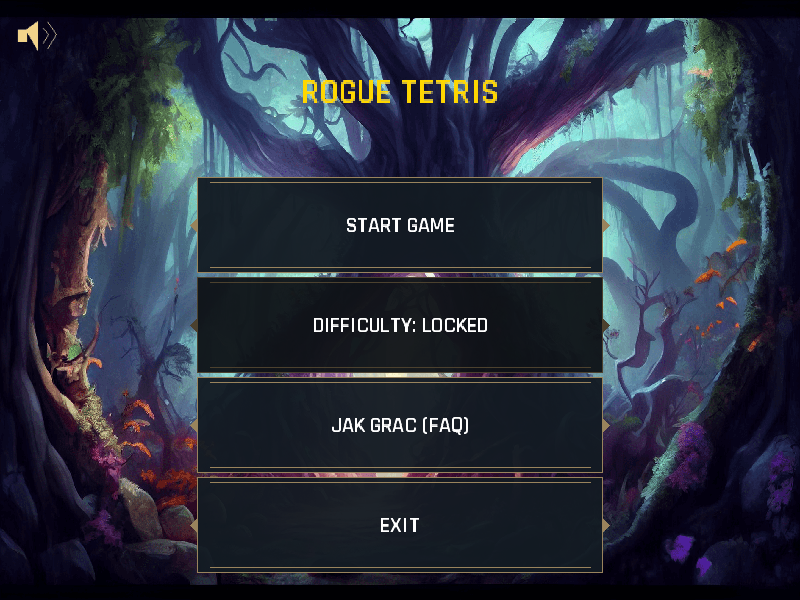
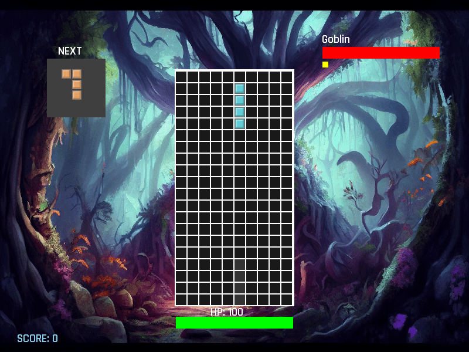

# RogueTetris

A bachelor's thesis game by **Raman Rasikhin** combining falling-block puzzles with roguelike progression. Clearing lines deals damage to enemies; a procedurally generated map offers battles, elite encounters, rest stops and random events.



## Play

**Windows x64:** download `RogueTetris-Windows-x64.zip` from [Releases](https://github.com/RamanRasikhin/rogue-tetris/releases), extract the entire folder and double-click **start.bat**. This package includes Eclipse Temurin Java; no separate Java installation is needed.

**JAR / other platforms:** requires **Java 17 or newer**:

```text
java -jar rogue-tetris-1.0.1.jar
```

On macOS use `java -XstartOnFirstThread -jar rogue-tetris-1.0.1.jar`. On Linux/macOS the desktop native libraries require a compatible graphical environment. The Windows build was smoke-tested; other operating systems were not tested.

## How it works

- Clear lines to damage enemies and build combos.
- Choose a route through a ten-layer procedural map.
- Collect artifacts that change health, damage, falling speed and other mechanics.
- Balance upgrades against health costs at rest stops and random events.
- Defeat the final boss and unlock higher difficulty levels.



## Stack

**Java 17 · libGDX · LWJGL3 · Gradle · JUnit 5**

| Module | Responsibility |
| --- | --- |
| core | Game logic, Tetris engine, map generation, progression, screens and tests |
| lwjgl3 | Desktop launcher and distribution task |
| assets | Credited CC BY graphics, OFL font and synthesized audio |
| tools | Reproducible sound generation |

The green **Code → Download ZIP** button downloads source code, not the ready-to-play Windows package. Its `start.bat` builds the game on first run and requires an installed **JDK 17+** plus internet access. The launcher logs build/startup errors under `logs/` rather than silently closing.

## Build and test

Use JDK 17 or newer. The Gradle wrapper downloads dependencies on first use.

```powershell
.\gradlew.bat core:test
.\gradlew.bat lwjgl3:run
.\gradlew.bat lwjgl3:dist
```

On Linux/macOS replace `.\gradlew.bat` with `./gradlew`. The distribution task creates `lwjgl3/build/libs/rogue-tetris-1.0.1.jar`.

## Controls

| Key | Action |
| --- | --- |
| Left / right | Move piece |
| Up | Rotate |
| Down | Soft drop |
| Space | Hard drop |
| 1 / 2 / 3 | Choose a decision or reward |

The source retains the original `K` presentation shortcut, which deals heavy damage to an enemy.

## Thesis and public edition

The game logic comes from my bachelor's thesis. For public portfolio publication, the original placeholder UI, block/marker art, font and sounds were replaced with source-generated resources or resources with explicit redistribution terms. The build was simplified for JDK 17. These changes are publication cleanup rather than additional thesis features.

The original thesis version is preserved separately. The screenshots here were captured from this public edition. See [CREDITS.md](CREDITS.md) for third-party authors, licenses and adaptations.

## Validation

The Gradle build, desktop distribution and all **8 existing JUnit tests** passed. A Windows desktop rendering smoke check loaded the actual resources and rendered the menu, map, battle and help screens. This checks startup and rendering, not every gameplay path or compatibility with every desktop OS.
